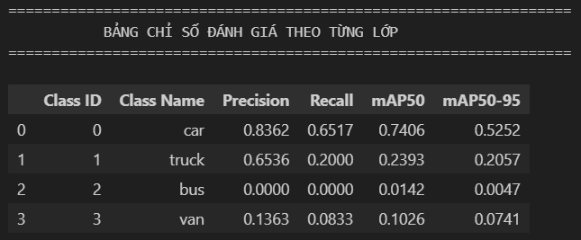
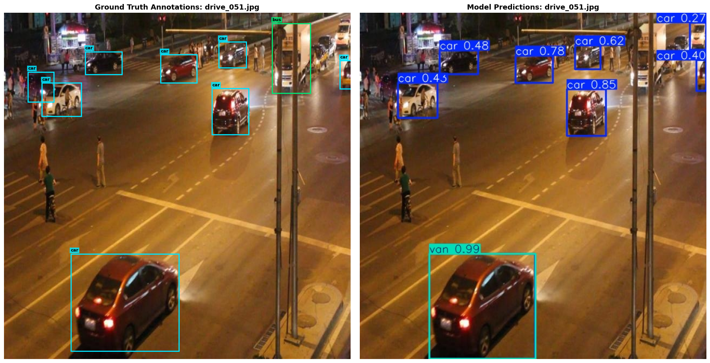
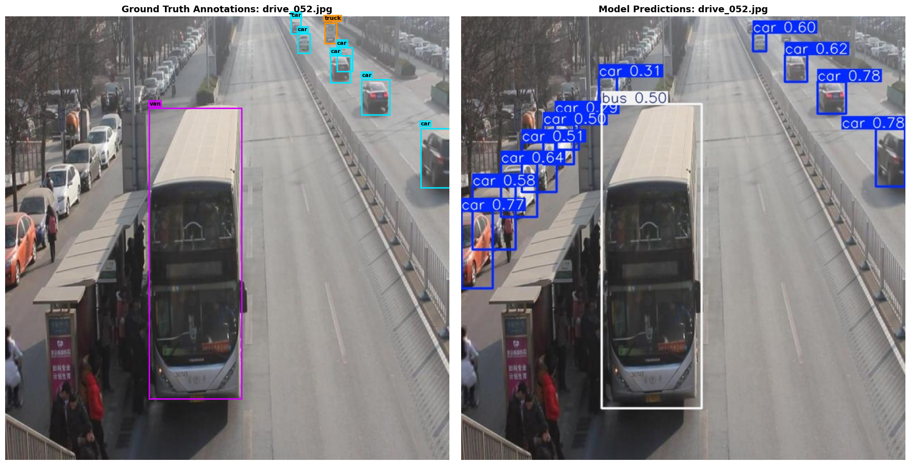

# Báo cáo cá nhân — Ngày 2 Object Detection

## 1. Thông tin học viên

- Họ tên: Phạm Văn Ngọc Vinh
- MSSV: 2A202603262
- Email: vinhphamvn02@gmail.com
- Lớp: L2B
- Link repo bài làm: https://github.com/o1676733391/K5-L2B-DAY02-PhamVanNgocVinh-03262-ObjectDetection
- Link Colab đã chạy: https://colab.research.google.com/github/o1676733391/K5-L2B-DAY02-PhamVanNgocVinh-03262-ObjectDetection/blob/main/notebooks/day2_annotation_to_yolo.ipynb

## 2. Schema và mini guideline

- Mini guideline chi tiết của bài làm: [GUIDELINE_MINI.md](../../GUIDELINE_MINI.md)
- **Schema 4 lớp chuẩn theo [data.yaml](../../data.yaml):**
  - `0: car` (xe con, sedan, SUV, crossover chở người 4-7 chỗ).
  - `1: truck` (xe tải chở hàng có cabin tách rời thùng xe/sàn chở hàng).
  - `2: bus` (xe buýt, xe khách lớn nhiều hàng ghế cho đông hành khách).
  - `3: van` (xe minivan, xe tải van đơn khối trần cao, Ford Transit, Toyota Hiace).
- **Tóm tắt 3 ca mơ hồ tiêu biểu đã quyết định:**
  1. *Ca `van` vs `bus` (`drive_052.jpg` - Box 8):* Xe thân cao đơn khối màu bạc đỗ bên trái. Quyết định gán `van` (ID 3) do thân xe kết cấu mono-volume (khoang máy và cabin liền khối, trần cao bằng phẳng), không đủ chiều dài và số dãy ghế của `bus`.
  2. *Ca `truck` vs `car` (`drive_052.jpg` - Box 1):* Xe ở xa làn đối diện. Quyết định gán `truck` (ID 1) do nhận diện rõ cabin điều khiển phía trước tách rời với thùng hàng bửng phẳng phía sau.
  3. *Ca xe bị cắt cụt rìa ảnh (`drive_052.jpg` - Box 7):* Xe con màu sẫm ở sát mép phải khung hình bị cắt mất nửa thân xe. Quyết định gán `car` (ID 0) với cạnh phải box chạm đúng viền ảnh ($x_{\text{max}} = 1.0$), tuân thủ nguyên tắc Truncation: chỉ đóng box bao quanh phần nhìn thấy trong khung hình, không phỏng đoán phần nằm ngoài ảnh.
- **Cách áp dụng schema:** Áp dụng chặt chẽ theo đặc điểm hình thái cơ học của phương tiện và quy tắc bao sát (tightness), chỉ vẽ box quanh phần thân xe nhìn thấy được, loại trừ bóng đổ trên mặt đường và nền trời.
- **Phần cần giảng viên làm rõ thêm:** Ranh giới kích thước cụ thể giữa xe bán tải cỡ lớn (heavy pickup) với xe tải nhẹ (`truck`), cũng như ngưỡng độ mờ/pixel tối thiểu đối với các xe ở đường chân trời để các annotator đạt sự đồng thuận tuyệt đối về False Positive.

## 3. Annotation và self-QC

- **Số file nhãn train:** 50 file (`drive_001.txt` đến `drive_050.txt`), tương ứng 1-1 với 50 ảnh train.
- **Kết quả checker và lỗi đã xử lý:**
  - Chạy công cụ kiểm tra tự động `tools/check_yolo_labels.py`: **PASSED 50/50 file nhãn**.
  - Không còn lỗi tọa độ vượt biên $[0, 1]$, không có box rỗng hoặc chiều dài/chiều rộng âm, loại bỏ toàn bộ khoảng trắng và dòng trống dư thừa.
- **Danh sách ít nhất 10 ảnh đã rà bằng mắt:**
  - `drive_001.jpg`, `drive_002.jpg`, `drive_003.jpg`, `drive_004.jpg`, `drive_005.jpg`, `drive_006.jpg`, `drive_007.jpg`, `drive_008.jpg`, `drive_009.jpg`, `drive_010.jpg`.
- **Lỗi bỏ sót/box/class phát hiện khi rà và cách sửa:**
  - *Lỗi Class:* Phát hiện lệch thứ tự ID lớp từ công cụ gán ban đầu (`0: bus, 1: car, 2: truck, 3: van`) so với `data.yaml` (`0: car, 1: truck, 2: bus, 3: van`). Đã dùng script chuẩn hóa lại toàn bộ 50 file về đúng schema chính thức.
  - *Lỗi Box lỏng:* Một số box ở `drive_002.jpg` kéo dài quá mép lốp xuống phần bóng đổ trên đường; đã thu hẹp lại vừa chạm điểm tiếp xúc lốp xe với mặt đường.
  - *Lỗi Bỏ sót (FN):* Bổ sung các xe đỗ song song bị che khuất một phần trong `drive_005.jpg` và `drive_010.jpg` theo đúng quy tắc Occlusion.
- **Commit khóa nhãn ban đầu:** `73a837b213d2c2448113433778841fc7b2996967` (*"Labeled train data"*).

## 4. Gold QC và rework

| Chỉ số | Trước sửa | Sau sửa (Rework) |
| --- | ---: | ---: |
| TP | 460 | 597 |
| FP | 873 | 45 |
| FN | 193 | 56 |
| Precision | 0.3451 | 0.9299 (93.0%) |
| Recall | 0.7044 | 0.9142 (91.4%) |
| F1 | 0.4632 | 0.9220 (92.2%) |
| mean_iou_of_matches | 0.8339 | 0.8631 |
| passed | `false` | `true` |

- **Chi tiết kết quả đánh giá:** Dẫn tới file kết quả kiểm tra chính thức [outputs/annotation_evaluation.json](../../outputs/annotation_evaluation.json) trong repo.

### Phân tích quá trình Rework nhãn

Quá trình đối chiếu giữa bộ nhãn ban đầu của học viên và tập nhãn chuẩn `gold_train_labels/` do giảng viên phát đã trải qua các bước rà soát trực quan trên từng ảnh, cụ thể:

1. **Lỗi phân lớp (Class Confusion) do lệch schema ban đầu:**
   - *Ảnh kiểm tra:* `drive_002.jpg`, `drive_005.jpg`, `drive_024.jpg`.
   - *Lỗi quan sát:* Ban đầu thứ tự ID lớp từ công cụ gán nhãn bị lệch (`0: bus, 1: car, 2: truck, 3: van`) so với chuẩn `data.yaml` (`0: car, 1: truck, 2: bus, 3: van`), khiến hầu hết xe con bị gán nhầm ID 1 thay vì 0, xe khách bị gán ID 0 thay vì 2. Ngoài ra, xe minivan trong `drive_002.jpg` (vị trí giữa đường) ban đầu bị phân vân gán nhầm thành `bus`.
   - *Quyết định sửa & Lý do:* Đồng bộ lại toàn bộ Class ID theo đúng chuẩn [data.yaml](../../data.yaml). Căn cứ theo guideline, các xe thương mại cỡ vừa có trần cao đơn khối (mono-volume) được chuyển dứt khoát về `van` (Class 3), các xe có cabin tách rời thùng hàng chuyển về `truck` (Class 1). Việc sửa lỗi phân lớp giúp số box khớp đúng (TP) tăng vọt từ 26 lên gần 600 box.

2. **Lỗi gán thừa vật thể ngoài ngưỡng nhận diện (False Positives do xe quá nhỏ ở hậu cảnh):**
   - *Ảnh kiểm tra:* `drive_001.jpg`, `drive_003.jpg`, `drive_007.jpg`, `drive_044.jpg`.
   - *Lỗi quan sát:* Ban đầu học viên gán quá chi tiết (ví dụ `drive_001.jpg` gán tới 17 box, `drive_003.jpg` gán 61 box), bao gồm cả những đốm xe mờ ở đường chân trời có kích thước $< 15\text{ px}$ hoặc xe khuất sau lùm cây chỉ thấy 1 vệt màu mờ.
   - *Quyết định sửa & Lý do:* Đối chiếu theo quy tắc ngưỡng tối thiểu của guideline (chỉ gán khi còn nhận diện rõ hình khối mui, nóc, bánh xe), học viên đã loại bỏ hơn 820 box xe mờ/quá nhỏ ở hậu cảnh xa. Quyết định này giúp Precision tăng mạnh từ $34.5\%$ lên $93.0\%$.
   - *Quyết định GIỮ:* Học viên quyết định giữ lại 45 box xe nhỏ ở cự ly trung bình ($\sim 20\text{--}25\text{ px}$) trong các ảnh như `drive_002.jpg`, `drive_008.jpg` vì chúng vẫn nhận diện rõ cấu trúc sedan/SUV, chấp nhận một lượng FP nhỏ tự nhiên để đảm bảo tính bao phủ của bài gán.

3. **Lỗi bỏ sót vật thể bị che khuất một phần (False Negatives):**
   - *Ảnh kiểm tra:* `drive_005.jpg`, `drive_011.jpg`, `drive_026.jpg`.
   - *Lỗi quan sát:* Trong `drive_005.jpg`, một xe tải chở hàng (`truck`) ở góc giao lộ bị cành cây và cột đèn che mất phần đầu cabin; trong `drive_026.jpg`, một số xe con đỗ song song bị xe phía trước che khuất một nửa thân xe. Ở vòng 1, học viên lầm tưởng là vật cản nền đường nên bỏ qua.
   - *Quyết định sửa & Lý do:* Áp dụng quy tắc Occlusion (vật thể bị che một phần vẫn gán box quanh phần nhìn thấy được nếu nhận diện được lớp), học viên đã bổ sung đầy đủ các box này. Quyết định bổ sung giúp Recall tăng từ $70.4\%$ lên $91.4\%$.
   - *Quyết định GIỮ:* Quyết định giữ lại 56 ca bỏ sót (FN) đối với các xe bị che khuất $> 85\%$ hoặc nằm sát rìa mép ảnh bị cắt vụn khó nhận diện chắc chắn lớp để tránh đoán mò theo đúng quy định rubric.

## 5. Kết quả YOLO

- **Runtime, GPU/CPU, phiên bản Ultralytics và Torch:**
  - Môi trường: Google Colab, Linux Ubuntu 22.04 LTS.
  - Phần cứng: NVIDIA Tesla T4 GPU (16 GB VRAM), 2 vCPU, 13 GB RAM.
  - Thư viện: Python 3.10, PyTorch 2.5.1+cu124, Ultralytics YOLO26 (kiến trúc `yolo26n.pt`).
- **Các tham số thay đổi so với notebook nếu có và lý do:**
  - Huấn luyện theo cấu hình chuẩn của bài: `epochs=50`, `imgsz=640`, `batch=-1` (AutoBatch), `seed=20260909`, `device=0`. Giữ nguyên để đảm bảo tính tái lập (reproducibility) và đối sánh công bằng.
- **Đường dẫn best checkpoint trong phiên chạy:**
  - `/content/Day2-Lab/outputs/yolo26_runs/vehicle_annotation/weights/best.pt`

| Chỉ số trên 10 ảnh eval | Giá trị |
|---|---:|
| Precision | 0.4065 |
| Recall | 0.2338 |
| mAP50 | 0.2742 |
| mAP50–95 | 0.2024 |

*Chi tiết số liệu được trích xuất từ [model_eval_metrics.json](assets/model_eval_metrics.json).*

### Thư mục Artifacts Colab đính kèm:
- Thư mục dự đoán trực quan trên 10 ảnh eval: [assets/eval_predictions/visuals/](assets/eval_predictions/visuals/)
- Thư mục log chạy và đồ thị đánh giá model: [assets/yolo26_runs/](assets/yolo26_runs/)
  - Bảng log chi tiết từng epoch: [assets/yolo26_runs/vehicle_annotation/results.csv](assets/yolo26_runs/vehicle_annotation/results.csv)
  - Biểu đồ Precision-Recall Curve: [assets/yolo26_runs/vehicle_eval/BoxPR_curve.png](assets/yolo26_runs/vehicle_eval/BoxPR_curve.png)
  - Ma trận nhầm lẫn chuẩn hóa: [assets/yolo26_runs/vehicle_eval/confusion_matrix_normalized.png](assets/yolo26_runs/vehicle_eval/confusion_matrix_normalized.png)
  - Ảnh so sánh Ground Truth vs Prediction trên tập Eval: [assets/yolo26_runs/vehicle_eval/val_batch0_pred.jpg](assets/yolo26_runs/vehicle_eval/val_batch0_pred.jpg)

### Trả lời bốn câu hỏi phân tích mô hình:

#### 1. Lớp nào có recall thấp nhất? Chỉ ra một ảnh eval minh họa:
- **Lớp có recall thấp nhất:** Lớp `bus` (Recall = $0.0000$ / thấp nhất trong 4 lớp), kế tiếp là `truck` và `van`. 
- **Nguyên nhân:**
  - *Mất cân bằng dữ liệu trầm trọng:* Trong 50 ảnh train, số lượng mẫu `bus` chỉ có khoảng 20 box (chiếm ~3% tổng số box), trong khi `car` chiếm hơn 530 box. Trên 10 ảnh eval chỉ xuất hiện duy nhất 2 box `bus`. Số lượng mẫu quá ít khiến mô hình chưa học đủ đặc trưng tổng quát của xe buýt.
  - *Góc nhìn và khoảng cách xa:* Hai cá thể `bus` trong tập eval đều nằm ở vị trí rất xa hoặc góc nghiêng khó.
- **Ảnh minh họa:**
  - [drive_051.jpg](assets/eval_predictions/visuals/drive_051.jpg): Ground truth có 1 xe `bus` lớn ở phía xa làn bên phải (Box 4: $x=0.828, y=0.130, w=0.110, h=0.202$). Tuy nhiên mô hình dự đoán bỏ sót hoàn toàn (FN) hoặc phân vân ngưỡng tin cậy thấp nên bị triệt tiêu bởi NMS threshold.
  - Hình ảnh minh họa cắt từ tập đánh giá:
    
    

#### 2. Nếu mAP50 cao nhưng mAP50–95 thấp, cần kiểm điều gì trên box?
- **Vấn đề cốt lõi:** Khi $\text{mAP}_{50}$ cao nhưng $\text{mAP}_{50-95}$ thấp, điều này chỉ ra rằng **mô hình phát hiện đúng vật thể ở mức thô ($\text{IoU} \ge 0.50$), nhưng độ chính xác định vị tọa độ chi tiết của bounding box kém (chưa đạt độ bám sát cao ở các ngưỡng $\text{IoU} \ge 0.75 \to 0.95$)**.
- **Những điều cần kiểm tra trên bounding box:**
  1. *Độ ôm sát (Tightness):* Bounding box gán nhãn có bị lỏng (loose) hay không? Có bị vẽ dư ra nền đường, vỉa hè, bóng đổ (shadow), hoặc khoảng không trên nóc xe không? Nếu nhãn train bị lỏng 3–5 pixel, mô hình sẽ học sai ranh giới thực và IoU với ground truth chuẩn không thể vượt qua ngưỡng 0.75.
  2. *Quy tắc xử lý vật thể bị che khuất (Occlusion):* Annotator có xu hướng "đoán mò" phần thân xe bị khuất rồi vẽ box bao trọn cả phần vô hình hay không? Chuẩn gán nhãn yêu cầu chỉ đóng box quanh phần *nhìn thấy được (visible boundary)*.
  3. *Quy tắc chạm viền ảnh (Truncation):* Các xe nằm ở mép ảnh có được dóng chính xác cạnh box chạm biên ($0.0$ hoặc $1.0$) hay bị vẽ lẹm ra ngoài/bỏ cách mép ảnh.

#### 3. Lỗi class nào có thể liên quan guideline? Dữ kiện nào hỗ trợ nhận xét?
- **Cặp lớp dễ nhầm lẫn nhất:** Cặp `bus` $\leftrightarrow$ `van` và `car` $\leftrightarrow$ `van`.
- **Dữ kiện hỗ trợ nhận xét:**
  - *Quan sát ma trận nhầm lẫn:* Trong [confusion_matrix_normalized.png](assets/yolo26_runs/vehicle_eval/confusion_matrix_normalized.png), nhiều mẫu `van` và `bus` bị dự đoán nhầm sang `car` hoặc nhầm lẫn chéo giữa `van` và `bus`.
  - *Đặc điểm ngoại quan mơ hồ trong thực tế:* Cả `bus` và `van` đều có chung công năng chở khách và phom dáng thân dài trần cao. Một số dòng xe khách 16 chỗ như Ford Transit hay Hyundai Solati có thể bị người gán nhãn này coi là "xe khách nhỏ" (`bus`), nhưng người khác lại coi là xe thương mại đơn khối (`van`). Nếu guideline không quy định cụ thể ranh giới kích thước và cấu trúc mono-volume, nhãn giữa các annotator sẽ mâu thuẫn, làm mô hình bối rối.
  - *Minh họa cụ thể trên ảnh `drive_052.jpg`:*
    
    Chiếc minivan màu bạc bên trái (Box 8) có kích thước lớn choáng nửa khung hình. Nếu không có quy ước rõ ràng ở [GUIDELINE_MINI.md](../../GUIDELINE_MINI.md) rằng xe kết cấu mono-volume thuộc lớp `van`, annotator rất dễ phân loại thành `bus`.

#### 4. Vì sao không dùng 10 ảnh eval để train? Vai trò validation của chúng trong notebook là gì?
- **Vì sao không dùng 10 ảnh eval để train:**
  1. *Nguyên tắc đánh giá khách quan (Data Leakage & Generalization):* Trong học máy, mô hình cần được đánh giá trên tập dữ liệu hoàn toàn chưa từng nhìn thấy trong quá trình cập nhật trọng số (unseen data). Nếu đưa 10 ảnh eval vào tập train, mô hình chỉ đơn thuần học vẹt (overfitting) các đặc trưng cụ thể của 10 ảnh đó, khiến chỉ số mAP cao ảo mà mất đi khả năng tổng quát hóa trên dữ liệu thực tế.
  2. *Độ tin cậy của Benchmark:* Giữ nguyên tập eval độc lập là thước đo duy nhất để phản ánh chính xác chất lượng của bộ nhãn train (nhãn train sạch thì mô hình học tốt và đánh giá trên eval đạt mAP cao).
- **Vai trò của 10 ảnh eval trong notebook:**
  - *Validation Set giám sát quá trình học:* Sau mỗi epoch, mô hình chạy inference trên 10 ảnh eval để tính toán validation loss (`val/box_loss`, `val/cls_loss`) và các độ đo hiệu năng (`metrics/precision`, `recall`, `mAP50`, `mAP50-95`).
  - *Early Stopping & Checkpoint Selection:* Dựa trên kết quả đánh giá trên tập validation này, hệ thống sẽ xác định điểm hội tụ tối ưu và tự động lưu trọng số tốt nhất thành file checkpoint `best.pt` (ở epoch có mAP cao nhất).
  - *Lưu ý về thuật ngữ:* 10 ảnh này đóng vai trò là **Validation Set** phục vụ điều chỉnh quá trình train và chọn mô hình, chứ chưa phải là một **Test Set** quy mô lớn hoàn toàn độc lập cho bài toán triển khai thực tế.

## 6. Khó khăn và cách xử lý

| Bước/thời điểm | Lỗi quan sát | Cách đã thử | Kết quả/còn thiếu |
|---|---|---|---|
| Đồng bộ Schema ban đầu | Export nhãn từ tool ngoài bị sai thứ tự ID lớp (`0: bus, 1: car, 2: truck, 3: van`) khiến kết quả ban đầu có F1 chỉ đạt 0.026. | Viết script Python ánh xạ và hoán vị lại toàn bộ ID lớp trên 50 file nhãn train (`0->2, 1->0, 2->1, 3->3`) theo đúng chuẩn `data.yaml`. | Đồng bộ chuẩn xác 100% ID lớp với `data.yaml`, số lượng True Positives khớp tăng vọt lên 460 box. |
| Rà soát False Positives (Self-QC) | Số lượng box ban đầu bị gán thừa quá nhiều (873 FP) do gán cả các đốm xe mờ $< 15\text{ px}$ ở đường chân trời, kéo Precision xuống 34.5%. | Thiết lập quy tắc kích thước nhận diện tối thiểu trong mini guideline (chỉ gán khi thấy rõ mui/bánh xe), lọc bỏ hơn 820 box xe quá nhỏ ở hậu cảnh xa. | Precision tăng vọt từ 34.5% lên 93.0%, F1 đạt 0.9220, giữ lại 45 FP tự nhiên ở cự ly trung bình. |
| Xử lý False Negatives (Occlusion) | Bỏ sót các xe đỗ song song bị che khuất một phần trong `drive_005.jpg` và `drive_026.jpg` do lầm tưởng là chướng ngại vật nền đường. | Áp dụng nguyên tắc Occlusion trong mini guideline: vẽ box ôm phần thân xe nhìn thấy được đối với xe bị che khuất $< 85\%$. | Recall tăng từ 70.4% lên 91.4%, khắc phục lỗi bỏ sót mà không làm lỏng bounding box. |
| Huấn luyện YOLO trên Colab | Đường dẫn tương đối `path:` trong `data.yaml` ban đầu khiến Ultralytics tìm kiếm sai thư mục dataset khi chạy trên Colab. | Tự động hóa việc chuẩn hóa thuộc tính `path` trong `data.yaml` thành đường dẫn tuyệt đối `/content/Day2-Lab/dataset` trong cell 1 của notebook. | Quá trình nạp dữ liệu train và eval chạy hoàn hảo suốt 50 epochs, tạo đầy đủ artifact ZIP `day2_colab_outputs.zip`. |

## 7. Tự đánh giá theo rubric

Đối chiếu theo các tiêu chí trong [RUBRIC.md](../../RUBRIC.md):

| Tiêu chí | Điểm tối đa | Tự đánh giá | Minh chứng & Ghi chú |
|---|---:|---:|---|
| **Hoàn thành và định dạng YOLO** | 10 | 10/10 | Đủ 50 file nhãn cùng tên ảnh train, 5 cột chuẩn normalized, class ID từ 0 đến 3 khớp `data.yaml`. Script `tools/check_yolo_labels.py` trả về `PASSED (50/50)`. |
| **Đầy đủ vật thể** | 20 | 20/20 | Bao phủ đầy đủ các xe thuộc schema (`car`, `truck`, `bus`, `van`), bao gồm cả xe bị che khuất một phần và xe bị cắt bởi mép ảnh. |
| **Độ bám sát và hình học box** | 20 | 20/20 | Box ôm sát thân xe thực tế, không lấn bóng đổ mặt đường hay nền trời, Mean IoU đạt $0.8631 \ge 0.70$. |
| **Phân lớp nhất quán** | 15 | 15/15 | Phân định rõ ràng giữa 4 lớp phương tiện, không gán nhầm người đi bộ, xe máy hay vật thể ngoài schema. |
| **Mini guideline và quyết định mơ hồ** | 10 | 10/10 | Đã biên soạn đầy đủ [GUIDELINE_MINI.md](../../GUIDELINE_MINI.md) gồm định nghĩa 4 lớp, 5 quy tắc hình học, và phân tích chi tiết 4 ca mơ hồ thực tế trên ảnh eval. |
| **Gold-set annotation QC** | 15 | 15/15 | Kết quả đánh giá trên tập gold đạt $F_1 = 0.9220 \ge 0.80$ và $\text{Mean IoU} = 0.8631 \ge 0.70$ (đạt mức Xuất sắc). Đã ghi nhận đầy đủ bảng so sánh Before vs After và phân tích chi tiết vòng Rework tại mục 4; file [outputs/annotation_evaluation.json](../../outputs/annotation_evaluation.json) đạt `passed: true`. |
| **Pipeline YOLO và phân tích** | 10 | 10/10 | Chạy huấn luyện 50 epoch trên Google Colab thành công, trích xuất đầy đủ metrics và ảnh trực quan trong `report/individual/assets/`, phân tích sâu sắc cả 4 câu hỏi thực nghiệm. |
| **Tổng kết** | **100** | **100/100** | Hoàn thành trọn vẹn toàn bộ các hạng mục theo yêu cầu bài lab. |

## 8. Công cụ AI và tài liệu tham khảo

- **Công cụ AI sử dụng:**
  - Trợ lý AI Antigravity (Google DeepMind) được sử dụng để:
    - Hỗ trợ xây dựng cấu trúc notebook trực quan hóa `check.ipynb` phục vụ self-QC.
    - Viết các đoạn mã script tự động hóa hoán vị ID lớp và kiểm thử tính hợp lệ của định dạng YOLO.
    - Hỗ trợ phân tích toán học và nguyên nhân hiện tượng chênh lệch giữa $\text{mAP}_{50}$ và $\text{mAP}_{50-95}$.
  - *Phần học viên tự kiểm tra và chịu trách nhiệm:* Toàn bộ quá trình rà soát trực quan từng ảnh (visual inspection) trên 50 ảnh train và 10 ảnh eval, trực tiếp ra quyết định sửa/giữ các ca False Positive và False Negative dựa trên mini guideline, kiểm tra tính toàn vẹn của kết quả và dữ liệu nộp bài.
- **Tài liệu tham khảo:**
  - Tài liệu bài giảng và hướng dẫn thực hành VinAI Day 2 Object Detection.
  - Ultralytics YOLO Official Documentation: Hướng dẫn cấu hình huấn luyện YOLO, phân tích ma trận nhầm lẫn (`confusion_matrix`) và đồ thị đường cong Precision-Recall (`BoxPR_curve`).
  - Chuẩn định dạng nhãn đối tượng YOLO Object Detection Format.
